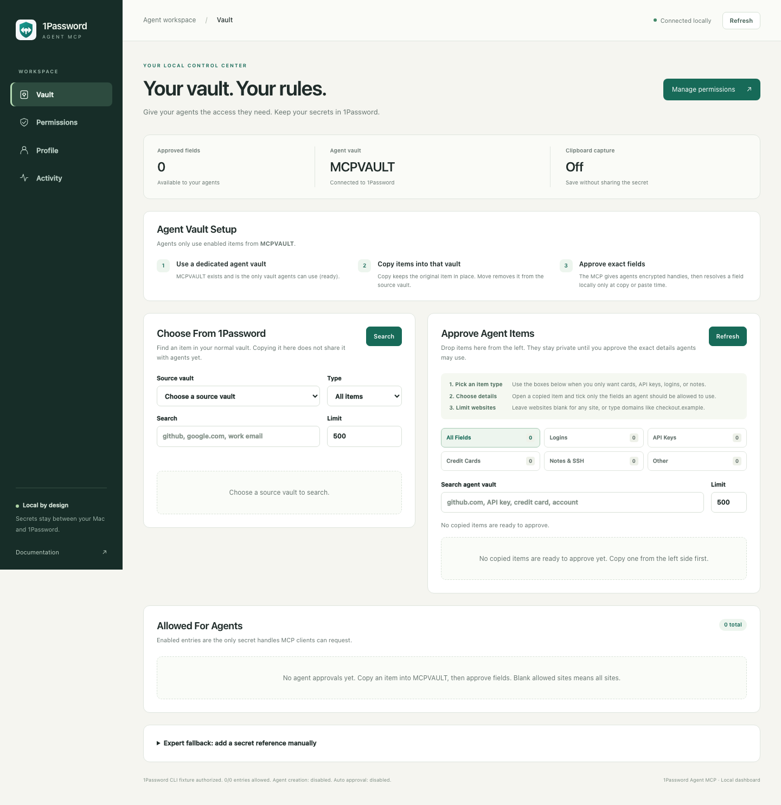
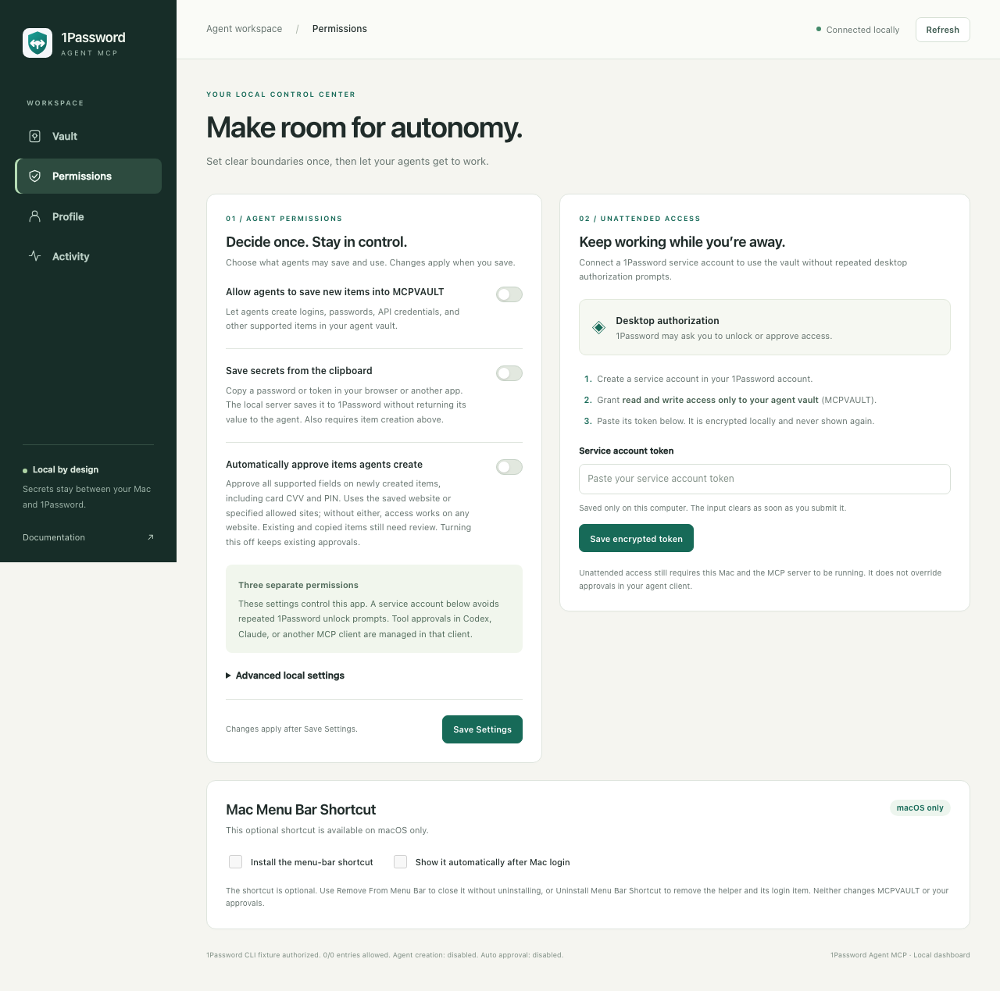

# User Guide

This guide uses synthetic example vaults and items. Your install uses the 1Password account configured on your computer, or the scoped service account you choose in the dashboard.

## The Simple Model

1Password Agent MCP uses one dedicated vault for AI agents:

```text
MCPVAULT
```

Put only the items you are comfortable letting agents use into that vault. Then approve exact fields for specific websites.



Use the sidebar to switch between four views:

- **Vault**: create the agent vault, copy items, review fields, and manage **Allowed For Agents**.
- **Permissions**: configure saving, clipboard capture, automatic approval, unattended access, and the optional Mac menu-bar shortcut.
- **Profile**: manage contact details that agents may read directly.
- **Activity**: review recent local operations without secret values.

**Refresh** updates the connection and lists. Changes in the permissions form apply when you click **Save Settings**.

## First Run

Install the package:

```bash
npm install -g onepassword-agent-mcp
```

Run the guided installer:

```bash
onepassword-agent-mcp install
```

It explains each change before making it. On a Mac, you may choose a visible menu-bar shortcut; launch at login is a separate optional question and defaults to off.

Check your machine:

```bash
onepassword-agent-mcp doctor
```

Start the local console:

```bash
onepassword-agent-mcp admin
```

Open:

```text
http://127.0.0.1:7319
```

## Step 1: Create MCPVAULT

Open **Vault**. If **Agent Vault Setup** says `MCPVAULT does not exist yet`, click **Create MCPVAULT**.

That creates an empty 1Password vault. It does not copy, move, or approve anything yet.

## Step 2: Copy Or Move Items Into MCPVAULT

In **Vault**, use **Choose From 1Password**:

1. Pick your source vault, such as `Private`.
2. Pick a type filter, such as **API keys** or **Credit cards**, when you do not want a mixed list.
3. Search by item name, website, category, or account label.
4. Drag the item from the left list onto the **Approve Agent Items** panel on the right.
5. Choose **Copy** or **Move** in the small confirmation window.

You can also use an item’s **Copy** or **Move** button instead of dragging.

Use **Copy** first when you are unsure. Copy leaves the original item in the source vault and duplicates its fields into `MCPVAULT`.

Use **Move** only when you want the item removed from the source vault. 1Password creates a new item in the destination vault, so the item ID changes.

The source search shows up to 500 items by default. After a copy, the left list stays in place; after a move, the moved item is removed from the visible list without reloading the whole source vault.

## Step 3: Approve Agent Fields

After a copied or moved item is inside `MCPVAULT`, it appears under **Approve Agent Items**. It needs approval before agents can use it. Items saved by agents can use the optional automatic approval setting described below.

Use the boxes at the top of that panel to manage each type independently:

- **Logins** for login/password items.
- **API Keys** for API Credential items.
- **Credit Cards** for cardholder, number, CVV, PIN, and expiry fields.
- **Notes & SSH** for secure notes and SSH keys.
- **Other** for remaining supported concealed/custom fields.

Think of this section as a checklist:

1. Pick the type box you want, such as **Credit Cards**.
2. Find the copied item. It appears once, even if it contains several fields.
3. Click **Review Details**.
4. Read the simple field names and tick only what the agent may use.
5. Enter allowed sites, such as:

```text
github.com, *.github.com
```

Leave allowed sites blank when the approved details may be used on any URL.

6. Click **Approve Selected**.

For credit cards, suggested details are usually cardholder name, card number, and expiry date. CVV and PIN are shown separately and are not suggested by default.

Approved details appear under **Allowed For Agents**. Agents can request encrypted handles for those entries, but the MCP copy/paste tools do not return plaintext field values.

Supported fields include normal login passwords, API credentials, credit-card number/CVV/expiry fields, secure-note text, SSH private keys, and many custom concealed fields.

## Automatically Approve Items Agents Create

If you want agents to use their newly saved items immediately, open **Permissions** and turn on **Automatically approve items agents create**, then click **Save Settings**. Keep **Allow agents to save new items into MCPVAULT** enabled too.

Automatic approval defaults to off. When enabled, it approves all supported fields after the new item is saved and verified in the configured agent vault. For credit cards this includes CVV and PIN. The entries appear under **Allowed For Agents**, where you can edit their sites, disable them, or delete their approvals.

You can also enable or disable it from the terminal:

```bash
onepassword-agent-mcp settings auto-approve on
onepassword-agent-mcp settings auto-approve off
onepassword-agent-mcp settings --json
```

The CLI and admin page share the same setting. It applies to subsequent saves without an MCP restart. Add `--dry-run` to preview a CLI change.

- Automatic approvals use the save's allowed sites, or its website if no allowed sites were supplied. Without either, the fields can be used on any website.
- Agents can pass `approveForAgents: false` to skip approval for a particular save.
- Existing items and items copied or moved through the console still need review.
- Turning this setting off keeps existing approvals. A save retry cannot restore an approval you disabled or deleted.

## Save Copied Secrets Without Showing Them To The Agent

In **Permissions**, enable **Allow agents to save new items into MCPVAULT** and **Save secrets from the clipboard**, then click **Save Settings**. Both settings default to off. Automatic approval is a separate choice.

1. Copy the intended secret using the website’s **Copy** button, or select text in a local app and use Copy. The agent should perform the copy without reading the value, clipboard, DOM field, or an image that reveals it.
2. Ask the agent to call `save_secret_from_clipboard` with a title, a stable `requestId`, and any non-secret category, website, or username metadata. Never put the secret in a tool argument or title.
3. Check the returned save and verification status. If automatic approval is off, review the saved item under **Vault → Approve Agent Items** before agents use it.

Supported categories are `login`, `password`, `api_credential`, and `secure_note`. Text, including spaces and newlines, is preserved exactly. The clipboard must be on the computer running this MCP; a remote browser has a separate clipboard.

The local process encrypts a retry snapshot that is usable for 15 minutes. Retry with the same `requestId` and metadata to reuse that snapshot even if the clipboard changes. An expired capture fails; check the previous save in 1Password before deliberately copying again with a new ID. Clipboard clearing rechecks the value and is best effort; read `clipboardStatus` and any cleanup warning. Clipboard history tools may retain their own copies.

See the [clipboard example](../README.md#save-from-the-browser-or-selected-text) for metadata-only arguments. `save_secret_item` is still available for values already in an agent’s context, but cannot undo that exposure.

## Unattended Access



Open **Permissions** and use the **Unattended access** card headed **Keep working while you’re away.**

1. Create a 1Password service account with access only to your dedicated agent vault. Give it read access and, if agents will save items, write access.
2. Paste the token directly into **Service account token** in this local dashboard; do not send it in chat.
3. Click **Save encrypted token**. The input clears immediately, and the token is stored encrypted on this computer.
4. Click **Test connection**. A successful result confirms the vault is reachable; it does not test write permission.

**Use saved service account** pauses or resumes the saved credential. **Remove saved token** removes its local encrypted file; revoke the token in 1Password to invalidate it everywhere. If the dashboard says **Managed by environment**, update `OP_SERVICE_ACCOUNT_TOKEN` in the process environment instead: it takes precedence over the local token.

A scoped service account can only see its assigned vaults. Copy items from your desktop account into the agent vault before enabling it, or pause it when you need other desktop-account vaults. It does not grant access to built-in Personal, Private, or Employee vaults.

This removes repeated desktop authorization prompts for supported service-account operations. The computer and MCP server must still be running. Your MCP client’s tool confirmations remain controlled by that client; dashboard permissions and automatic field approval are separate settings.

## Save Agent-Created Items To A Normal Vault

If you enable **Allow agents to save new items into MCPVAULT**, the agent can create a login, API key, secure note, credit card, or password item. It is saved into the agent vault first, not your normal vaults.

When you trust the new item:

1. Open **Vault → Approve Agent Items**.
2. Click **Review Details** on the item.
3. Choose a destination under **Save this item to another vault**.
4. Click **Copy To Vault** to keep the agent-vault copy, or **Move To Vault** to remove it from `MCPVAULT`.

Moving an item out of `MCPVAULT` also removes local agent approvals for that copied item.

## Step 4: Add Profile Data

Open **Profile** and use **Profile Data For Agents** when an agent needs contact or identity details that are not a 1Password secret field:

- email address
- phone number
- mailing address
- name
- company
- username

Profile data is stored locally by this app and returned directly through the `get_profile_data` MCP tool. Use allowed sites when a value should only be used on specific websites. Leave allowed sites blank when it may be used anywhere.

## Delete An Agent Vault Item

In **Vault → Approve Agent Items**, open **Review Details**, then click **Delete Item** to remove the item from `MCPVAULT`. The separate **Delete** button under **Allowed For Agents** removes only that approval.

The console asks for confirmation first. 1Password moves deleted items to Recently Deleted, and any local agent approval for that item is removed.

## What Agents Can Do

Agents can:

- Ask which approved secret fields match the current website.
- Receive encrypted local handles.
- Ask the MCP to copy or paste a field.
- Save new logins, passwords, API credentials, secure notes, or credit cards into `MCPVAULT` after you enable that write permission in local settings.
- Capture a copied secret locally without returning its value when both clipboard saving and item creation are enabled.
- Read profile data that you added under **Profile**.

Agents cannot:

- Search your whole 1Password account through the MCP.
- See plaintext 1Password secret fields in model responses from copy/paste tools.
- Use entries that are not enabled under **Allowed For Agents**.
- Use a secret for the wrong site unless you turn on the unsafe advanced setting.

## What Is The Expert Fallback?

Most users should ignore **Expert fallback: add a secret reference manually**.

Use it only when the normal search cannot show the exact field you need, for example a custom API token field. The secret reference must point at an item in `MCPVAULT`, for example:

```text
op://MCPVAULT/GitHub deploy token/password
```

The app encrypts that reference locally. It still does not store the field value.

## What Are Advanced Local Settings?

Open **Permissions → Advanced local settings**. Most users can leave these alone.

- `Agent vault name`: the dedicated vault agents may use. Default: `MCPVAULT`.
- `1Password CLI path`: where the `op` command lives. Default: `op`.
- `Account`: optional account shorthand or sign-in address.
- `Clipboard clear seconds`: when the app attempts to clear an unchanged copied field value. Clipboard capture has its own immediate clear attempt.
- `Allow paste without expected site`: keep this off. It removes the site safety check.

Saving, clipboard capture, and automatic approval are the three main switches above **Advanced local settings**. Click **Save Settings** after changing them.

## Best Practice

Use desktop 1Password CLI integration for interactive local use.

For unattended use, configure a service account scoped only to `MCPVAULT` through **Permissions**, or supply `OP_SERVICE_ACCOUNT_TOKEN` in the MCP process environment. See [Unattended Access](#unattended-access).

## Is It Always Running?

No. Installing 1Password Agent MCP adds local commands and lets MCP clients launch the server when needed. The npm installation itself does not install a startup item or hidden background service.

- The approval console runs only while `onepassword-agent-mcp admin` is running.
- The MCP server runs only when an MCP client launches `onepassword-agent-mcp mcp`.
- Client setup writes client config, so the client can launch the MCP later.
- The optional Mac menu-bar app is installed only when you choose it and is visible while running. It starts the admin console only when you ask.
- Restarting the computer does not auto-start this project unless you separately enabled **Launch Menu Bar at Login** or an MCP client starts it.

If you choose **Remove From Menu Bar**, the helper stays installed; run `onepassword-agent-mcp menubar launch` to show it again. If you choose **Uninstall Menu Bar Shortcut**, run `onepassword-agent-mcp menubar install` to reinstall it. The menu's **Stop Admin Console** action and `onepassword-agent-mcp admin stop` can stop the console even when it was originally started somewhere else.

Run this any time:

```bash
onepassword-agent-mcp runtime
```

## Optional Mac Menu Bar

Use **Permissions → Mac Menu Bar Shortcut** to install or uninstall the clearly labeled **1P** menu item. **Open Admin Console** starts the console when needed and opens it. **Remove From Menu Bar** only closes the helper, while **Uninstall Menu Bar Shortcut** removes the installed helper after confirmation. Neither action changes MCP configuration or 1Password data.

The app is compiled locally from readable Swift source. It lives in your user `Applications` folder, requires no administrator password, and can be removed without deleting approvals or anything in 1Password.

## Uninstall

1. Stop the admin console with `Ctrl-C`.
2. Disconnect clients:

```bash
onepassword-agent-mcp uninstall all
onepassword-agent-mcp uninstall all --apply
```

3. Optional: remove local state while the command is still installed:

```bash
onepassword-agent-mcp uninstall state --apply
```

This removes `~/.onepassword-mcp`, including approvals, the encryption key, clipboard retry records, and any locally saved service-account token. It does not delete `MCPVAULT` or any 1Password item, or revoke the service-account token at 1Password.

4. Remove the npm package:

```bash
npm uninstall -g onepassword-agent-mcp
```
